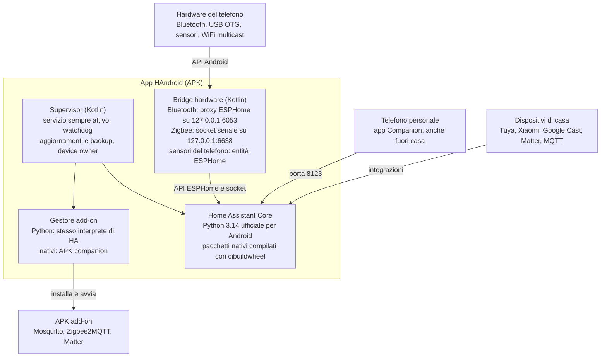

# HAndroid: Home Assistant nativo su Android

12 novembre 2026 · versione modificabile: [HAndroid su Claude](https://claude.ai/artifact/SYwCcowPZbvN4x8w671skB)

## Obiettivo

HAndroid è un'app Android che fa girare il vero Home Assistant Core dentro l'APK, senza root, Docker o Termux. L'app usa l'hardware del telefono come radio della casa: Bluetooth, USB e sensori.

L'app deve garantire:

- Home Assistant all'ultima versione, aggiornabile dall'app pochi giorni dopo ogni release.
- Bluetooth funzionante per i sensori BLE (es. termometri Xiaomi) e per i dispositivi che richiedono una connessione attiva.
- Chiavetta Zigbee USB collegata con cavo OTG e usata da ZHA.
- Add-on scaricati solo quando servono e rimossi quando non servono più.
- Server attivo 24/7, anche dopo un riavvio, senza toccare il telefono.

Telefono di riferimento: Xiaomi 12T (Dimensity 8100, 8 GB di RAM, Android 14 con MIUI dopo il ripristino di fabbrica del 2026-11-13).

## Perché le soluzioni attuali sono limitate

Termux, udocker e Homedroid emulano un Linux dentro Android, e da questo nascono tutti i loro limiti.

- **Esecuzione bloccata.** Da Android 10 un'app può eseguire solo i programmi contenuti nel proprio APK. Per aggirare il blocco si usa proot, che intercetta ogni chiamata di sistema: l'avvio è più lento e compaiono errori strani (accesso negato a /proc/net/dev, adattatori IPv6).
- **Niente Bluetooth.** Home Assistant parla con BlueZ via D-Bus, ma Android non ha BlueZ. Nessuna delle soluzioni attuali risolve il problema.
- **Niente add-on.** Gli add-on ufficiali sono immagini Docker gestite dal Supervisor, e senza root il kernel di Android non le può eseguire.

**Cosa è cambiato:** da Python 3.14 CPython pubblica binari ufficiali per Android, e cibuildwheel compila i pacchetti nativi per Android. Home Assistant richiede proprio Python 3.14, quindi oggi può girare nativamente dentro un'app, senza alcuna emulazione.

## Architettura

Un solo APK contiene Home Assistant Core, un supervisor in Kotlin, i bridge verso l'hardware e il gestore degli add-on. Il telefono personale si collega alla porta 8123 come a qualsiasi server Home Assistant.



Il supervisor sostituisce l'HA Supervisor di HA OS: avvia e controlla Home Assistant, installa gli add-on, fa backup e aggiornamenti. Home Assistant resta quello originale e non modificato.

## Bluetooth, USB e sensori del telefono

Home Assistant non tocca mai l'hardware direttamente. Un bridge in Kotlin usa le API di Android e presenta l'hardware a HA in un formato che HA già conosce, quindi non serve nessuna patch a Home Assistant.

| Hardware | API Android | Come lo vede Home Assistant |
| --- | --- | --- |
| Bluetooth LE | BluetoothLeScanner, BluetoothGatt | Un proxy Bluetooth ESPHome su 127.0.0.1:6053 (scansione passiva e connessioni attive) |
| Chiavetta Zigbee USB | USB Host + usb-serial-for-android | ZHA con porta `socket://127.0.0.1:6638` |
| Chiavetta Z-Wave USB | USB Host, stesso socket | Z-Wave JS, come add-on |
| Sensori (batteria, temperatura, luce, movimento) | SensorManager, BatteryManager | Entità dello stesso dispositivo ESPHome |
| Torcia, schermo, altoparlante | CameraManager, PowerManager, MediaPlayer | Switch e media player dello stesso dispositivo |
| WiFi e mDNS | ConnectivityManager, MulticastLock | Elenco interfacce corretto: zeroconf e auto-discovery funzionano |

Risultato: in HA compare un dispositivo "HAndroid" con tutti i sensori del telefono, e il Bluetooth funziona come con un ESP32 proxy. Il limite resta il numero di connessioni BLE attive che Android consente insieme (di solito poche).

## Sistema di add-on

Gli add-on sono pacchetti piccoli che scarichi dall'app solo quando servono. Ognuno è descritto da un manifest YAML; il formato è nostro, perché quello Docker ufficiale su Android non può funzionare.

```yaml
name: Mosquitto
version: 2.0.20
type: native          # python | native
ports: [1883]
permissions: [network]   # network | bluetooth | usb | storage
options:
  allow_anonymous: false
schema:
  allow_anonymous: bool
```

Ci sono due tipi di add-on:

- **python:** un servizio scritto in Python che gira come processo separato, con lo stesso interprete di HA. Si installa senza permessi speciali e pesa pochi MB.
- **native:** programmi compilati per arm64 (Mosquitto, Node per Zigbee2MQTT, Matter Server, go2rtc), distribuiti in un piccolo APK companion. Android esegue solo codice che arriva da un APK, quindi l'app installa l'APK companion e ne avvia i binari.

Dal manifest l'app genera da sola la schermata delle opzioni e il pannello nella barra laterale di HA. L'indice degli add-on è un file JSON su GitHub: chiunque può aggiungere un repository, come in HA OS.

## Restare sempre acceso

Il trucco è rendere l'app **device owner** del telefono: una volta fatto, HyperOS non può più chiuderla. Il comando si dà una sola volta, subito dopo il ripristino di fabbrica e prima di aggiungere qualsiasi account:

```bash
adb shell dpm set-device-owner it.handroid/.AdminReceiver
```

Cosa ottieni come device owner: niente ottimizzazione batteria, permessi concessi in automatico, aggiornamenti di sistema rimandati, riavvio programmato e app non disinstallabile per errore.

Altri accorgimenti:

- Servizio in primo piano con wakelock parziale e WifiLock ad alte prestazioni, avviato al boot.
- Telefono senza PIN, così il server riparte da solo dopo un riavvio. I dati di HA vanno nella memoria cifrata per dispositivo, leggibile anche prima dello sblocco.
- Il supervisor controlla HA ogni 30 secondi e lo riavvia se non risponde. Dopo 3 crash di fila parte in modalità provvisoria.
- **Batteria:** senza root un'app non può fermare la ricarica. Il sensore batteria integrato pilota una presa smart che accende il caricatore sotto il 30% e lo spegne all'80%.

## Roadmap

Si parte dalla prova di fattibilità (M0). Se Home Assistant non parte nell'APK, il resto del progetto non ha senso.

| Milestone | Contenuto | Gate (test per passare alla successiva) |
| --- | --- | --- |
| **M0 · Fattibilità** | Home Assistant parte dentro l'APK con Python 3.14 ufficiale; elenco delle dipendenze native da compilare per Android | UI di HA aperta su :8123 dal telefono personale |
| **M1 · Server affidabile** | Supervisor: servizio, avvio al boot, watchdog, backup; aggiornamento di HA dall'app; modalità device owner | 7 giorni di fila senza interventi manuali |
| **M2 · Hardware** | Bluetooth come proxy ESPHome, chiavetta Zigbee via socket, sensori del telefono, auto-discovery mDNS | Termometro BLE Xiaomi e lampadina Zigbee visibili in HA |
| **M3 · Add-on** | Manifest, indice su GitHub, add-on Python e APK nativi; primi add-on: Mosquitto, Zigbee2MQTT, Matter Server | Add-on installato e rimosso senza riavviare HA |
| **M4 · Rilascio** | APK su GitHub e F-Droid, installer ADB, documentazione, lista delle integrazioni testate | — |

Ogni gate è un test che si fa sul Xiaomi 12T: finché il test non passa, non si apre la milestone successiva.

## Rischi e domande aperte

Il rischio principale sono le dipendenze native: va scoperto nella M0, prima di scrivere qualsiasi altra cosa.

- [ ] **Pacchetti senza wheel Android.** HA usa decine di librerie in C o Rust (cryptography, orjson, pydantic-core, numpy…). Vanno compilate con cibuildwheel e pubblicate su un nostro indice pip. Un'integrazione che richiede un pacchetto non compilato non si installa: serve una lista di compatibilità.
- [ ] **Installazione dei requisiti a runtime.** HA usa uv per installare i pacchetti delle integrazioni. Bisogna verificare se uv gira su Android, altrimenti va sostituito con pip puntato al nostro indice.
- [ ] **Binari da un altro APK.** Da verificare su Android 15 che l'app principale possa eseguire i binari nativi di un APK companion. Il piano B è includere gli add-on nativi principali nell'APK, come moduli opzionali.
- [ ] **Google Play.** Le regole del Play Store limitano il codice scaricato ed eseguito. La distribuzione prevista è su GitHub e F-Droid.
- [ ] **Device owner senza account.** Il comando funziona solo su un telefono senza account Google o Xiaomi. Va bene per un server dedicato, ma va scritto chiaro nella guida.

### Fonti

- [BeeWare: binari Android ufficiali di CPython](https://beeware.org/news/buzz/august-2025-status-update)
- [cibuildwheel: supporto Android](https://cibuildwheel.pypa.io/en/stable/)
- [Homedroid](https://github.com/sudiptacmd/homedroid)
- [Guida HA Core su Android con udocker](https://community.home-assistant.io/t/simple-and-fast-installing-home-assistant-core-and-matter-server-on-android-no-root-no-qemu/788933)
